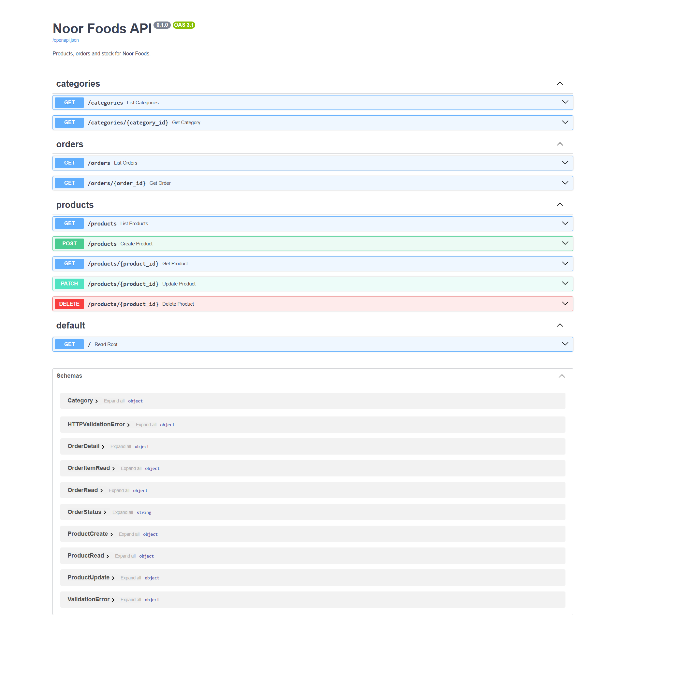
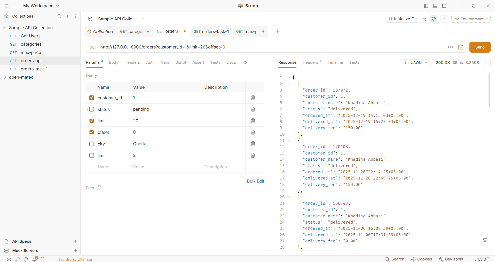

# Noor Foods API – Database & API Practice (Week 04)

A database-driven REST API developed using FastAPI and PostgreSQL as part of my Forward Deployed Engineer (FDE) learning journey.

This project focuses on connecting APIs with relational databases, working with SQLModel, managing database sessions, and implementing data retrieval and filtering.

## Table of Contents

- [Overview](#overview)
- [Features](#features)
- [Technologies Used](#technologies-used)
- [Database Setup](#database-setup)
- [API Functionality](#api-functionality)
- [Screenshots](#screenshots)
- [What I Learned](#what-i-learned)
- [Author](#author)

## Overview

Noor Foods API is a backend practice project designed to explore database integration and API development.

Unlike my previous in-memory API practice, this project introduces PostgreSQL for persistent data storage and SQLModel for working with database models and queries.

## Features

- Integration of FastAPI with PostgreSQL.
- Database modelling using SQLModel.
- Managing database sessions.
- Retrieving records from relational databases.
- Filtering products using query parameters.
- Filtering products by category.
- Filtering products using maximum price.
- Using Decimal for accurate monetary values.
- Database management and inspection using DBeaver.
- Running PostgreSQL using Docker.

## Technologies Used

- **Python** – Backend programming.
- **FastAPI** – REST API development.
- **SQLModel** – Database modelling and ORM.
- **PostgreSQL** – Relational database.
- **Docker** – Database containerization.
- **Bruno** – API testing.
- **DBeaver** – Database management.
- **UV** – Python package and project management.
- **Git & GitHub** – Version control.

## Database Setup

PostgreSQL was configured and run inside a Docker container.

DBeaver was used to connect to the database, inspect tables, and execute SQL queries.

## API Functionality

The project includes product-related API functionality, including:

- Retrieving products.
- Filtering products by category.
- Filtering products by maximum price.
- Combining multiple filters in a single request.

## Screenshots
- API documentation (Swagger UI).
- 
  
- Successful API requests and responses in Bruno
- 

### Links
- Solution URL: [Github](https://github.com/nidaismail/database-apis-practice-week-04)

## What I Learned

Through this project, I practised:

- Connecting FastAPI applications to PostgreSQL.
- Understanding SQLModel and ORM concepts.
- Working with database sessions.
- Writing database queries.
- Using query parameters for API filtering.
- Combining multiple filters in a single endpoint.
- Using Decimal for monetary values instead of float.
- Running and managing PostgreSQL through Docker.
- Testing API functionality using Bruno.
- Inspecting database structures using DBeaver.

## Author

**Nida Ismail**

- GitHub: [@nidaismail](https://github.com/nidaismail)

